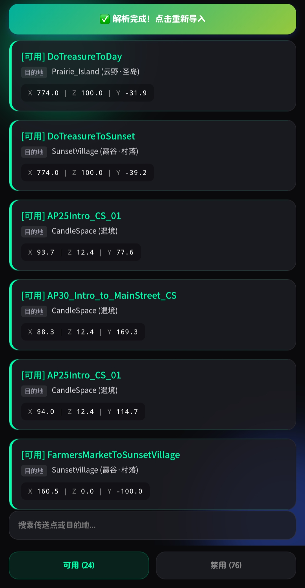

# Sky-Portal-preview
一款可与 Sky 模型查看器（Sky Model Viewer）配合使用的 Sky 传送点预览工具

## 🌟 SkyPortal v0.0.3.1 更新内容

### ✨ 新特性
- 全新极光暗黑 UI 界面，更护眼、更现代。
- 智能双引擎词典（断网使用内置词典，联网自动拉取云端最新词库）。
- 极致精简的文件选择器，自动过滤无关应用，并默认定位到 Download 目录。

### ⚡ 性能优化
- 开启 R8 代码压缩与资源清理。
- 移除无用架构，APK 体积大幅缩小。

### 📥 安装说明
- 由于修改了包名（`com.point.transport`），如果你是旧版用户，请**先卸载旧版**，再安装本版本。

  
### 📥 下载安装
1. 前往本仓库右侧的 **[Releases](../../releases)** 页面。
2. 找到最新版本（Latest）
3. 安装即可直接使用。
 
 

### ⚠️ 注意事项
这个软件需要搭配SkyModelViewer或SkyModelViewer-Android使用

Sky Model Viewer:https://github.com/kfhammond/SkyModelViewer

SkyModelViewer-Android:https://github.com/XianXiaoWei/SkyModelViewer-Android

### 🛠️ 主要功能
通过分析SkyModelViewer导出的地图节点JSON文件来找到所有LevelLink(传送点)

## 📱 界面预览

  

